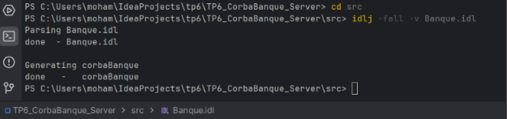
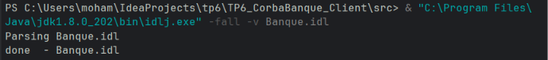
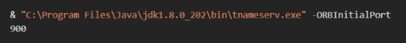
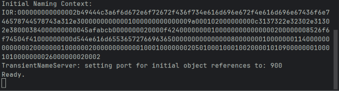
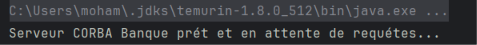
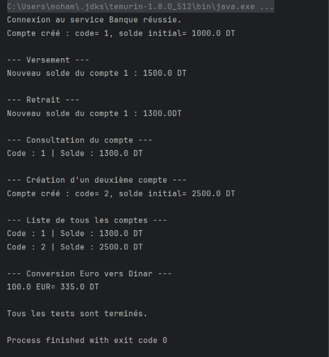
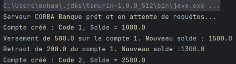

# TP6:
## Etape2:

Interprétation(Développement du Serveur, Définition IDL et Implémentation) :

L'utilisation de l'architecture CORBA (Common Object Request Broker Architecture) à
travers la spécification d'une interface en IDL (Interface Definition Language) établit
un contrat de service découplé et indépendant du langage entre le client et le serveur.
En structurant les données complexes (Compte) et en définissant un module
corbaBanque, le compilateur idlj génère automatiquement les stubs et squelettes
nécessaires à la sérialisation et au transport des objets via le protocole IIOP.
L'implémentation du servant (BanqueImpl) encapsule la logique métier au sein du
POA (Portable Object Adapter), tandis que l'enregistrement de la référence dans
l'annuaire JNDI (CosNaming) permet une localisation transparente et centralisée du
service distant par les clients sur le réseau.

## Etape3+4:

Interprétation (Développement et Communication du Client CORBA) :
Le client CORBA utilise les classes générées par le compilateur idlj à partir du fichier Banque.idl afin de
disposer d’un stub compatible avec le service distant. Le contexte JNDI, configuré par
le fichier jndi.properties, permet de rechercher dans l’annuaire CosNaming la
référence du service enregistré sous le nom « Banque ». La méthode
IBanqueRemoteHelper.narrow convertit cette référence générique en une référence
exploitable de type IBanqueRemote. Le client peut alors appeler à distance les
différentes opérations bancaires, notamment la création, la consultation et la gestion
des comptes ainsi que la conversion monétaire, tout en laissant CORBA assurer la
communication et le transport des données entre le client et le serveur.